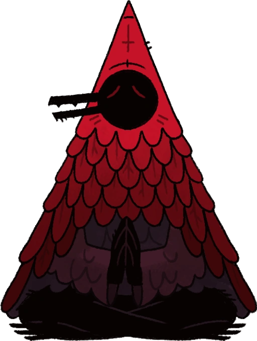
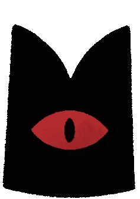
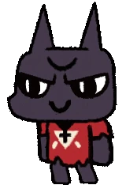

*«Славься, агнец; тебе дарована великая сила, чтобы освободить Того-кто-ждёт в небытии» -  • Клонек, Cult Of The Lamb* 

## Обо мне:
  • Что-ж, добро пожаловать в моё README.md. **Мой ник Phantom/Фантом, или же Phantomik/Фантомик.** Я обычный человек, который иногда пишет то, что придёт в голову, вроде как. Пишу программы с 13-14 лет. Люблю лазеть в Windows, и изучать как всё устроено. Всё остальное — в лс. ;)

 • Мои профили построены вокруг **антропоморфного кота из «Cult Of The Lamb, или же Культ Ягнёнка».** *по имени Нариндер/Тот-Кто-Ждёт.* Для меня он является лучшим персонажем в этом рогалике.

##  Языки Программирования которые знаю:

##  Я в:

